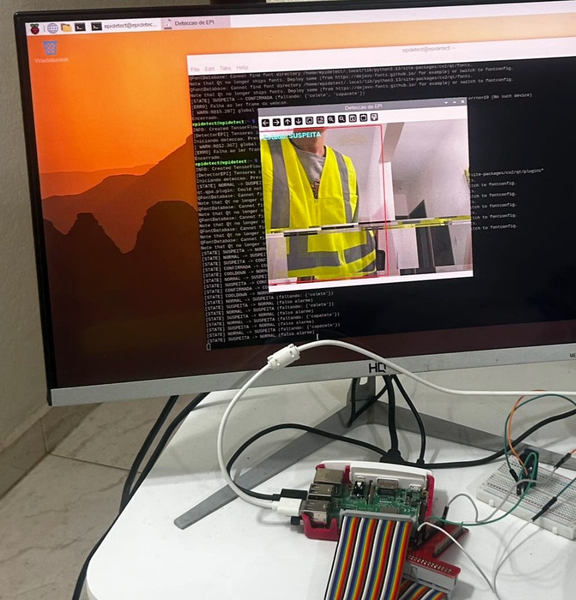
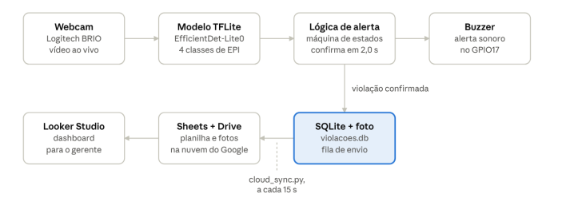
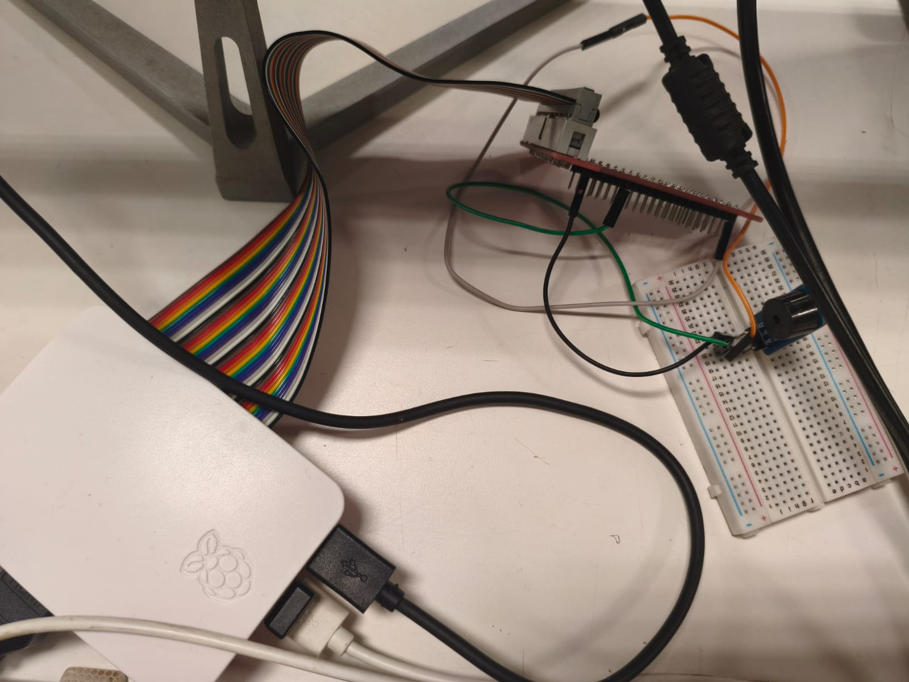
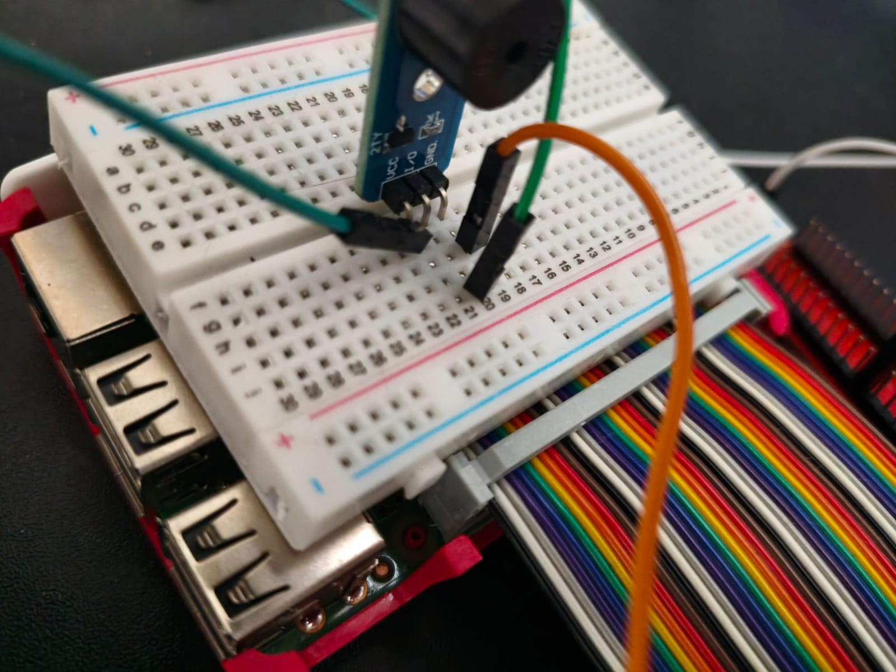

# Real-Time PPE Detection on Raspberry Pi 3B
### Detecção de EPI em tempo real com Raspberry Pi 3B

> **EN —** An embedded computer-vision system that checks, in real time, whether a worker is wearing a **hard hat** and a **safety vest**. It runs fully **on-device** on a Raspberry Pi 3B (1 GB RAM) with a TFLite object-detection model, triggers a **buzzer** with different patterns depending on how many items are missing, and logs every confirmed violation (timestamp + photo) in a local **SQLite** database that syncs to **Google Sheets / Drive** in the background — even after being offline.
>
> Built for the *Computer Architecture and Embedded Technologies* course (Computer Engineering, USF). Related to **UN SDG 9** (Industry, Innovation and Infrastructure).

**Stack:** Python · TensorFlow Lite (EfficientDet-Lite0) · OpenCV · gpiozero · SQLite · Google Sheets/Drive API · Raspberry Pi 3B

---

## Sumário / Contents

- [Visão geral](#visão-geral)
- [Como funciona](#como-funciona)
- [Hardware](#hardware)
- [Software e modelo](#software-e-modelo)
- [Estrutura do repositório](#estrutura-do-repositório)
- [Passo a passo para reproduzir](#passo-a-passo-para-reproduzir)
- [Como rodar](#como-rodar)
- [Resultados](#resultados)
- [Limitações](#limitações)
- [Licença](#licença)
- [Autor](#autor)





## Visão geral

O sistema usa uma webcam ligada a um Raspberry Pi 3B para classificar, quadro a quadro, a situação de EPI de quem está na frente da câmera em **4 classes**:

| Classe | Significado | Alerta |
|---|---|---|
| `colete_capacete` | Capacete e colete | Nenhum |
| `so_capacete` | Falta o colete | Buzzer intermitente |
| `so_colete` | Falta o capacete | Buzzer intermitente |
| `nenhum_EPI` | Falta tudo | Buzzer contínuo |

Tudo roda **localmente no Pi**, sem depender de internet para detectar e alertar. A nuvem é usada só para consolidar os registros.

## Como funciona

Fluxo completo: webcam → modelo TFLite → lógica de alerta (máquina de estados) → buzzer. Quando uma violação é confirmada, ela vai para o SQLite local com a foto e, em segundo plano (a cada 15 s), para o Google Sheets e o Drive, de onde pode alimentar um dashboard (diagrama no topo da página).

### Máquina de estados (anti falso-positivo)

Para não disparar alarme por um piscar de classificação, a violação passa por quatro estados:

```
NORMAL ──(EPI faltando)──► SUSPEITA ──(2 s contínuos)──► CONFIRMADA ──(EPI corrigido)──► COOLDOWN ──(5 s)──► NORMAL
                              │
                              └──(voltou ao normal)──► NORMAL   (falso alarme descartado)
```

- **SUSPEITA → CONFIRMADA:** só confirma se a mesma violação se mantiver por **2 segundos**.
- **Debounce em CONFIRMADA:** se o tipo de violação mudar (ex.: de "sem capacete" para "sem tudo"), a mudança só vale depois de ficar estável por 2 s; assim não gera registros duplicados.
- **COOLDOWN:** 5 s de espera antes de rearmar.
- Ao confirmar: aciona o buzzer, salva a foto e grava o registro.

### Registro local + sincronização offline-first

1. A violação é gravada **imediatamente** no SQLite (`registro.py`) com a foto do momento — operação rápida, não trava o vídeo.
2. Uma **thread de fundo** (`cloud_sync.py`) envia os pendentes para o Google Drive (foto) e Google Sheets (linha com data/hora, tipo e link da foto).
3. Sem internet? Os registros ficam como pendentes (`enviado_nuvem = 0`) e são enviados na próxima tentativa. **Nada se perde.**

Os dados na planilha podem alimentar um dashboard (ex.: Looker Studio) para visualizar violações por horário e tipo.

## Hardware

- Raspberry Pi 3B (1 GB RAM)
- Webcam Logitech BRIO
- Módulo de buzzer ativo no **GPIO17 (BCM)**
- Placa de extensão GPIO + protoboard

> O módulo de buzzer usado responde com **lógica invertida** (nível baixo aciona o som), por isso o código usa `active_high=False` no gpiozero. Se o seu módulo for "normal", troque para `True` em `ControleBuzzer`.
>
> Esquemático elétrico: [PDF](docs/esquematico_buzzer_raspberry_pi.pdf). Detalhes de hardware, software e método: [Materiais e Métodos (PDF)](docs/materiais-e-metodos.pdf).

| Montagem completa | Módulo do buzzer na protoboard |
|---|---|
|  |  |

## Software e modelo

- **Modelo:** EfficientDet-Lite0, treinado com `tflite-model-maker` no Google Colab, exportado como `best.tflite` (pós-processamento e NMS já embutidos).
- **Anotação:** Roboflow (exportação Pascal VOC), 4 classes.
- **Inferência no Pi:** interpretador TFLite puro (`ai-edge-litert` / `tflite-runtime`).
- **Por que não MediaPipe?** O pacote do MediaPipe trava com `Illegal instruction` no Pi 3B (o binário assume instruções AES em hardware que o chip BCM2837 não tem). A solução foi ler direto os tensores de saída do `.tflite`.
- **Detalhe de robustez:** o código identifica os tensores de saída pelo **formato (shape)**, e não pela posição na lista, porque a ordem retornada pelo interpretador pode vir embaralhada; também valida se os scores estão em [0, 1].

> O dataset e as fotos de violações **não** estão neste repositório (contêm imagens de pessoas).

## Estrutura do repositório

```
.
├── src/
│   ├── detect.py           # Inferência, buzzer, máquina de estados, loop principal
│   ├── registro.py         # SQLite + snapshot das violações
│   ├── cloud_sync.py       # Envio dos pendentes para Google Sheets/Drive
│   └── config.example.py   # Modelo de configuração da nuvem (copie para config.py)
├── models/
│   └── best.tflite         # Modelo treinado
├── docs/                   # Esquemático, Materiais e Métodos (PDFs) e imagens
├── requirements.txt
├── LICENSE
└── README.md
```

## Passo a passo para reproduzir

Resumo do caminho completo, do zero até o sistema rodando. O repositório já inclui o modelo treinado, então quem só quer testar pode ir direto ao passo 6.

1. **Materiais:** Raspberry Pi 3B (1 GB) com cartão SD e fonte micro-USB, webcam USB, módulo de buzzer ativo (3 pinos: VCC, I/O e GND), placa de extensão GPIO, protoboard e jumpers.
2. **Sistema do Pi:** instale o Raspberry Pi OS e habilite o SSH (opcional, mas facilita copiar arquivos e acessar remotamente).
3. **Montagem:** ligue o módulo do buzzer ao Pi passando pela placa de extensão e pela protoboard. O pino de sinal (I/O) vai no **GPIO17 (BCM 17, pino físico 11)**; VCC no pino físico 2 (5 V) e GND no pino físico 6 (confira a tensão aceita pelo seu módulo). O módulo usado aqui tem **lógica invertida**, por isso o código usa `active_high=False`.
4. **Dataset:** fotografe pessoas com e sem capacete e colete, variando iluminação e ângulo, e anote as 4 classes (`colete_capacete`, `nenhum_EPI`, `so_capacete`, `so_colete`) no **Roboflow**, exportando em **Pascal VOC**. Use os nomes das classes exatamente assim.
5. **Treino:** no **Google Colab**, use o `tflite-model-maker` para treinar um **EfficientDet-Lite0** (ele exige versões antigas do Python, então use um ambiente isolado com Python 3.9, por exemplo via Miniconda). Avalie, exporte o `best.tflite` e salve uma cópia no Google Drive para não perder se a sessão cair.
6. **Deploy no Pi:** clone este repositório no Pi (ou copie os arquivos) e confirme o modelo em `models/best.tflite`. Se você treinou o seu, copie-o para lá, por exemplo com `scp best.tflite usuario@IP_DO_PI:caminho/do/repo/models/`.
7. **Dependências:** `pip install -r requirements.txt --break-system-packages` (no Pi, o OpenCV costuma ser mais fácil via `sudo apt install python3-opencv`).
8. **Rodar:** `python3 src/detect.py` (pressione `q` na janela de vídeo para sair).
9. **Ajustes (se você retreinou):** confira a ordem das classes em `LABELS`, o `CONFIDENCE_THRESHOLD` e os tempos `TEMPO_CONFIRMACAO` e `TEMPO_COOLDOWN` no `src/detect.py`.
10. **Nuvem (opcional):** configure o Google Sheets/Drive como descrito na seção abaixo.

## Como rodar

> Testado em Raspberry Pi 3B com Raspberry Pi OS e Python 3.

```bash
# 1. Clone o repositório
git clone https://github.com/Eidyyy/epi-detection-raspberry-pi.git
cd epi-detection-raspberry-pi

# 2. Instale as dependências
pip install -r requirements.txt --break-system-packages
# (no Pi, o OpenCV costuma ser mais fácil via: sudo apt install python3-opencv)

# 3. Confirme que o modelo está em models/best.tflite

# 4. Rode a detecção (pressione 'q' na janela de vídeo para sair)
python3 src/detect.py
```

**Sem configurar a nuvem**, o sistema detecta, aciona o buzzer e registra localmente normalmente.

### (Opcional) Ativar a sincronização com Google Sheets/Drive

```bash
cd src
cp config.example.py config.py
# edite o config.py: IDs da planilha e da pasta do Drive + caminho das credenciais
python3 cloud_sync.py   # 1ª execução: autoriza o Drive e força uma sincronização
```

Você precisa de uma *Service Account* (Sheets) e de um cliente OAuth (Drive) do Google Cloud. **Nunca** suba `credentials.json`, `oauth_credentials.json`, `token.json` ou `config.py` para o GitHub — o `.gitignore` já bloqueia esses arquivos.

## Resultados

- Sistema **funcional em hardware real**: detecção das 4 classes, máquina de estados, padrões de buzzer (intermitente/contínuo), registro local e sincronização com a nuvem, inclusive **recuperação após queda de internet**.
- Métricas de avaliação reportadas pelo `tflite-model-maker` ao final do treino: **AP50 = 100%**, **AP75 = 94,7%**, **AP = 78,7%**.
  - *Atenção:* essas métricas foram medidas sobre o próprio conjunto de dados do projeto, sem um conjunto de teste separado confirmado. Elas indicam o ajuste do modelo aos dados e **não garantem** o mesmo desempenho em imagens novas.
- Testado em ambiente doméstico e em ambiente externo.

## Limitações

- **Uma pessoa por vez** no campo de visão da câmera (limitação de hardware e orçamento do projeto).
- Desempenho condicionado ao Raspberry Pi 3B (CPU, sem aceleração dedicada).
- Treinado com um conjunto de dados limitado e em condições controladas; para uso real seria necessário ampliar e diversificar o dataset (iluminação, ângulos, tipos de capacete/colete).

## Licença

Distribuído sob a licença **MIT** — veja o arquivo [LICENSE](LICENSE).

## Autor

**Murilo Eidy Menin Asano**
Engenharia de Computação — Universidade São Francisco (USF), Bragança Paulista/SP
Foco em cibersegurança (Blue Team / SOC)

---

<details>
<summary><b>English summary of key points</b></summary>

- **What:** real-time hard-hat + safety-vest detection on a Raspberry Pi 3B, fully on-device (EfficientDet-Lite0 via TFLite).
- **Alerts:** buzzer on GPIO17 — intermittent when one item is missing, continuous when both are.
- **False-positive control:** 4-state machine (NORMAL → SUSPEITA → CONFIRMADA → COOLDOWN); a violation must persist for 2 s to be confirmed.
- **Logging:** SQLite + photo snapshot; a background thread syncs pending records to Google Sheets/Drive, offline-tolerant.
- **Why not MediaPipe:** crashes with `Illegal instruction` on the Pi 3B's BCM2837 (no AES hardware instructions) — solved by using the plain TFLite interpreter and reading output tensors by shape.
- **Reproduce:** wire the buzzer to GPIO17 → label 4 classes in Roboflow (Pascal VOC) → train EfficientDet-Lite0 with `tflite-model-maker` in Colab → copy `best.tflite` to the Pi → run (see "Passo a passo para reproduzir").
- **Run:** `pip install -r requirements.txt` → put the model in `models/best.tflite` → `python3 src/detect.py`. Cloud sync is optional (`src/config.example.py`).
- **License:** MIT.

</details>
